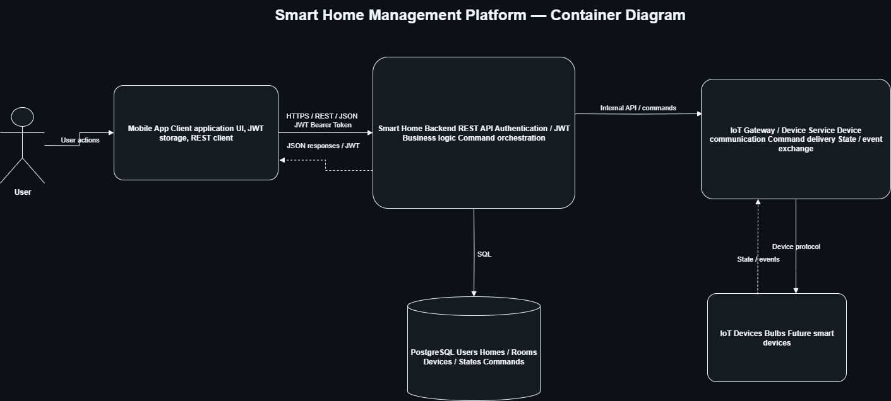

# Architecture

## Назначение раздела

В разделе представлена архитектура Smart Home Management Platform на уровне основных контейнеров и взаимодействий между ними.

Диаграмма показывает клиентское приложение, Backend, базу данных, компонент взаимодействия с IoT-устройствами и основные протоколы обмена данными.

---

## Архитектурная диаграмма

Исходный файл диаграммы:

- [smart-home-container.drawio](./smart-home-container.drawio)

---

## Основные компоненты

### User

Пользователь взаимодействует с системой через мобильное приложение.

### Mobile App

Клиентское приложение отвечает за:

- пользовательский интерфейс;
- отправку REST API запросов;
- хранение JWT access token;
- отображение состояния устройств и результатов выполнения команд.

### Smart Home Backend

Основной серверный компонент системы.

Отвечает за:

- REST API;
- регистрацию и авторизацию пользователей;
- проверку JWT;
- бизнес-логику;
- управление домами, комнатами и устройствами;
- создание и обработку команд устройств;
- взаимодействие с PostgreSQL;
- взаимодействие с IoT Gateway.

### PostgreSQL

Основное хранилище данных системы.

Содержит данные о:

- пользователях;
- домах и участниках;
- комнатах;
- устройствах и их типах;
- текущем состоянии устройств;
- командах и статусах их выполнения.

### IoT Gateway / Device Service

Компонент отвечает за взаимодействие Backend с физическими IoT-устройствами.

Основные функции:

- отправка команд устройствам;
- получение результатов выполнения команд;
- обмен состояниями и событиями устройств;
- абстрагирование Backend от конкретного протокола IoT-устройства.

### IoT Devices

Физические умные устройства, подключенные к платформе.

В первой версии системы основным типом устройства является умная лампа. Архитектура допускает добавление других типов устройств в дальнейшем.

---

## Основные взаимодействия

| Откуда | Куда | Взаимодействие |
|---|---|---|
| User | Mobile App | действия пользователя |
| Mobile App | Smart Home Backend | HTTPS / REST / JSON |
| Mobile App | Smart Home Backend | JWT Bearer Token |
| Smart Home Backend | PostgreSQL | SQL |
| Smart Home Backend | IoT Gateway / Device Service | внутренние команды и обмен данными |
| IoT Gateway / Device Service | IoT Devices | протокол взаимодействия с устройствами |
| IoT Devices | IoT Gateway / Device Service | состояния и события |

---

## Архитектурные решения

Backend реализован как единое приложение с выделенным компонентом взаимодействия с IoT-устройствами.

Такой подход позволяет не усложнять архитектуру на начальном этапе и при этом отделяет работу с физическими устройствами от основной бизнес-логики платформы.

REST API используется для взаимодействия Mobile App с Backend.

PostgreSQL используется в качестве основной реляционной базы данных.

JWT Bearer Token используется для аутентификации запросов к защищенным API endpoints.

---

## Статус

Завершено

---

## Связанные документы

- [API](../api/README.md)
- [ERD](../erd/README.md)
- [SQL](../sql/README.md)
- [BPMN](../bpmn/README.md)
- [UML](../uml/README.md)
- [Requirements](../requirements/README.md)