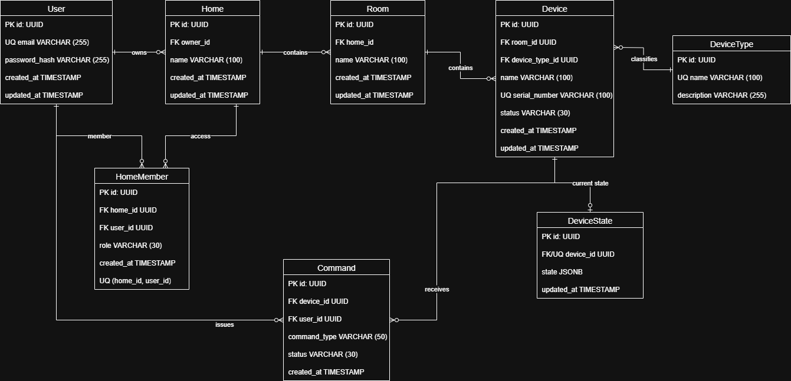

# ERD

## Назначение раздела

В разделе представлена модель данных Smart Home Management Platform.

ERD описывает основные сущности системы, их атрибуты и связи, необходимые для регистрации пользователей, управления домами, комнатами и устройствами.

---

## Цель моделирования

Спроектировать логическую структуру данных, которая поддерживает основные сценарии MVP:

- регистрацию пользователей;
- создание домов;
- добавление комнат;
- подключение устройств;
- управление устройствами;
- хранение текущего состояния устройств;
- предоставление совместного доступа к дому;
- хранение истории команд устройств.

---

## Основные сущности

| Сущность | Назначение |
|---|---|
| `User` | учетная запись пользователя |
| `Home` | дом, созданный пользователем |
| `HomeMember` | доступ пользователей к дому |
| `Room` | помещение внутри дома |
| `DeviceType` | тип устройства |
| `Device` | подключенное устройство |
| `DeviceState` | текущее состояние устройства |
| `Command` | история команд управления устройствами |

---

## Основные связи

- пользователь может владеть несколькими домами;
- дом может содержать несколько комнат;
- дом может содержать несколько устройств;
- устройство может быть привязано к комнате;
- устройство относится к определенному типу;
- устройство имеет текущее состояние;
- пользователи могут получать доступ к дому через `HomeMember`;
- команды связаны с устройством и пользователем, который их отправил.

---

## Артефакты

- логическая ERD в формате Draw.io;
- PNG-предпросмотр модели;
- описание сущностей и связей;
- первичные и внешние ключи;
- SQL-схема PostgreSQL.

---

## Диаграмма

---

## Файлы

- [ERD Diagram — v2](./smart-home_erd_v2.drawio)
- [PNG Preview — v2](./smart-home_erd_v2.png)

Предыдущая версия модели сохранена для демонстрации развития проекта:

- [ERD Diagram — v1](./smart-home_erd_v1.drawio)
- [PNG Preview — v1](./smart-home_erd_v1.png)

---

## Статус

Завершено

---

## Связанные документы

- [Functional Requirements](../requirements/05-functional-requirements/README.md)
- [Non-functional Requirements](../requirements/06-non-functional-requirements/README.md)
- [Use Cases](../requirements/08-use-cases/README.md)
- [Business Rules](../requirements/09-business-rules/README.md)
- [BPMN](../bpmn/README.md)
- [SQL](../sql/README.md)
- [API](../api/README.md)